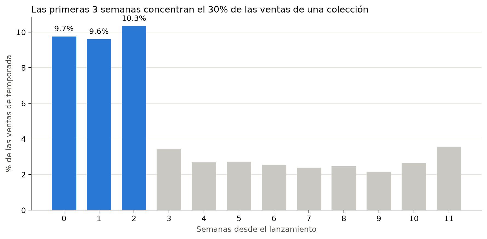
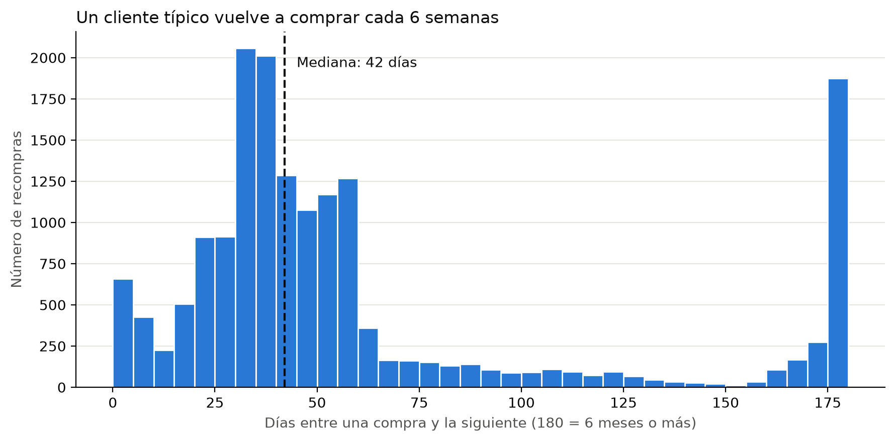
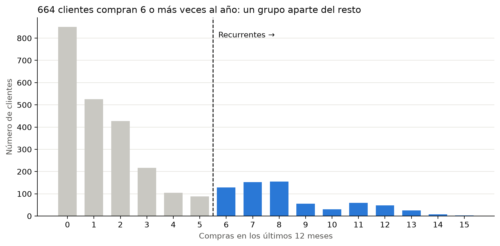
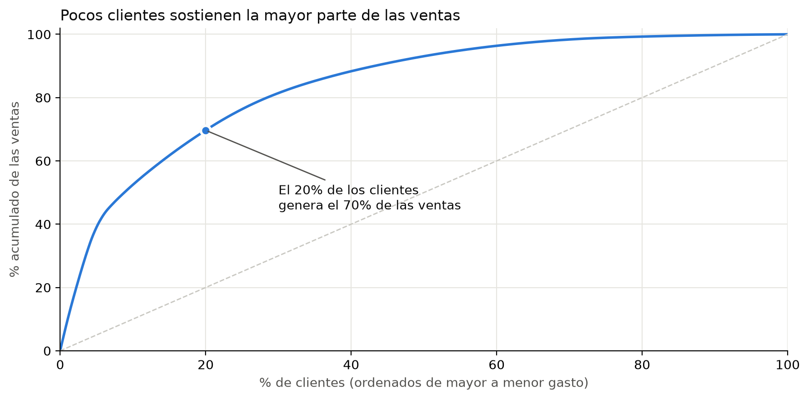
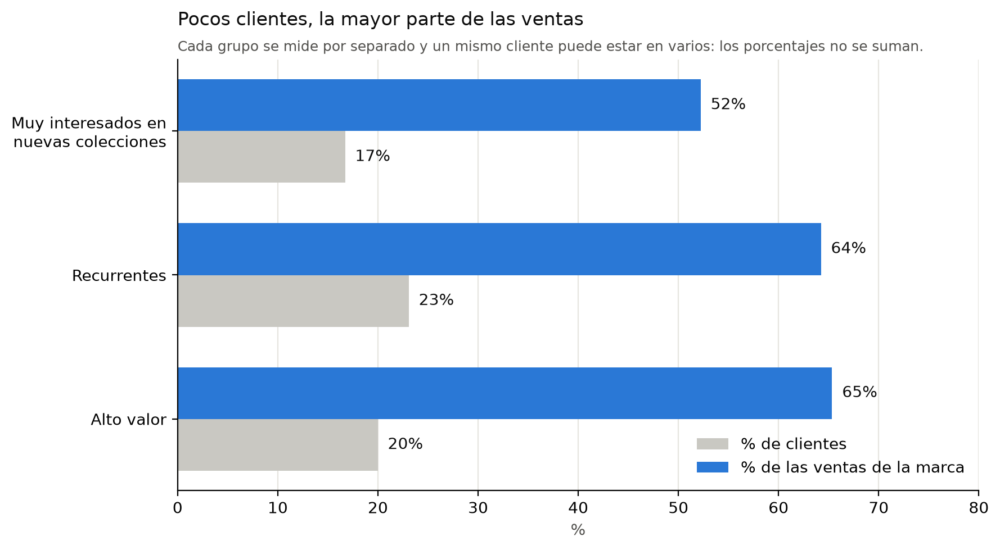
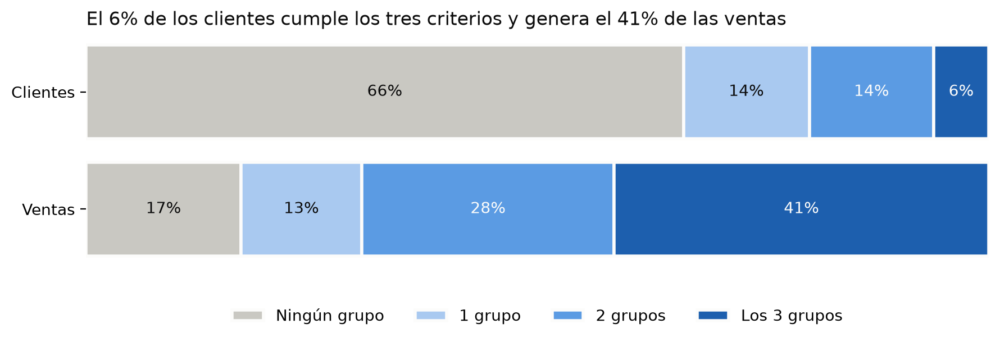
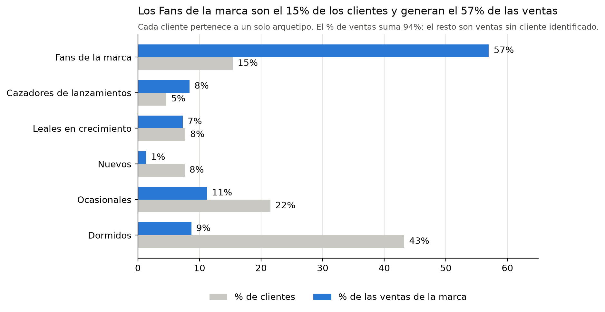

# Análisis de clientes de una marca de moda

Análisis de clientes de una marca de moda con tienda online y 5 tiendas físicas: calidad de datos, interés en novedades, recurrencia, valor y arquetipos de cliente.

Los datos cubren unos 3.000 clientes de una marca mexicana, de enero de 2024 a septiembre de 2026. El análisis responde tres preguntas:

1. ¿Qué clientes muestran interés en las nuevas colecciones?
2. ¿Qué clientes son recurrentes?
3. ¿Qué clientes aportan más valor?

Con esas respuestas se construyen 6 arquetipos de cliente, cada uno con una acción de marketing distinta.

## Estructura

```
retail-customer-analytics/
├── data/                  # datos crudos y procesados (no versionados: contienen datos personales)
│   └── processed/
├── notebooks/
│   ├── 01_limpieza.ipynb  # revisión de calidad: problema, tratamiento e impacto de cada hallazgo
│   └── 02_analisis.ipynb  # tres preguntas y arquetipos
├── reports/
│   ├── figures/           # gráficos usados en este README y en el resumen ejecutivo
│   └── resumen_ejecutivo.pdf
├── requirements.txt
└── README.md
```

## Cómo ejecutarlo

```bash
python -m venv .venv
source .venv/bin/activate        # Windows: .venv\Scripts\activate
pip install -r requirements.txt
```

1. Copiar los 5 CSV originales (customers, orders, order_items, products, stores) en data/.
2. Ejecutar notebooks/01_limpieza.ipynb de principio a fin. Genera los archivos limpios en data/processed/.
3. Ejecutar notebooks/02_analisis.ipynb. Genera las tablas de resultados y las figuras en reports/figures/.

## Calidad de datos

Antes de analizar se revisó cada tabla. Cada revisión tiene un código (C = customers, O = orders, I = order_items, P = products, X = cruce entre tablas) y queda registrada en data/processed/resumen_calidad.csv. Estos son los hallazgos con impacto:

| Código | Problema | Tratamiento | Impacto si no se corrige |
|---|---|---|---|
| C1 | 116 personas registradas dos veces (cuenta online y de tienda; mismo email con distinta capitalización) | Se unificaron: ID y fecha de registro más antiguos, datos de contacto más recientes. 3.122 → 3.006 clientes | Se cuentan clientes de más y cada persona aparece con la mitad de su historial |
| C2 | 8 emails con formato inválido | Se marcaron con email_valido; no se corrigieron porque no se puede saber el email correcto | Rebotes en campañas de email |
| C4 | 42 fechas de nacimiento imposibles (más de 100 años o en el futuro) | Se dejaron vacías | Edades falsas en cualquier análisis por edad |
| C5 | 48 teléfonos sin prefijo de país y 8 incompletos | Se agregó el prefijo 52; los incompletos se dejaron vacíos. Se crearon contactable_email y contactable_whatsapp | Mensajes de WhatsApp que no llegan |
| C6 | notas_crm es texto libre y 3 notas contienen instrucciones ("Lineamiento CRM 2026", segmento "Litoral-B") | Se convirtió en indicadores (nota_evento_lanzamiento, nota_prefiere_whatsapp, etc.) y se eliminó el texto libre. Las instrucciones no se aplicaron | Riesgo de *prompt injection* si el texto se envía a una IA; criterios de negocio no validados |
| O3 | 40 IDs de cliente en pedidos que no existen en customers (840 pedidos) | Se marcaron con cliente_atribuible; cuentan en las ventas de la marca, no en la segmentación | Pedidos asignados a nadie o a un cliente equivocado |
| O4 | 381 pedidos de 166 clientes son anteriores a su fecha de registro (mediana de 414 días) | Se creó cliente_desde = la fecha más antigua entre registro y primera compra | Antigüedad de clientes subestimada |
| I1 | 627 líneas duplicadas exactas en 620 pedidos | Se eliminaron | Ventas infladas en 746.816 MXN (1,3%) |
| I2 | Cuenta de pruebas (QA) con 50, 99 y 120 unidades por línea | Se eliminó la cuenta | Ventas infladas en 2.484.817 MXN (4,5%); la cuenta de QA aparecería como el cliente más valioso |
| I2 | 16 cuentas internas @marcamoda.mx (compras de personal: 23% de descuento promedio frente al 8% del resto; una cuenta de mostrador con 420 pedidos) | Se marcaron con cuenta_interna y se excluyeron de la segmentación | Empleados clasificados como los mejores clientes |
| I3 | 59 líneas con SKU fuera del catálogo (rango SKU9xxx) | Se marcaron con sku_en_catalogo | Ventas sin colección ni categoría |
| I4 | El precio unitario es el precio de lista; el descuento no está aplicado | Venta neta = cantidad × precio × (1 − descuento/100) | Ventas sobreestimadas |
| P2 | La colección OI26 está escrita de 6 formas distintas | Se normalizó a mayúsculas, sin espacios ni guiones | Una colección partida en 6 |
| P3 | 1.886 líneas (5,8%) vendidas antes del lanzamiento de su producto | Se marcaron con coleccion_valida; no se usan para medir interés en novedades | Compras "en lanzamiento" que no lo son |

En total, el 5,8% de las ventas brutas venía de registros que no son ventas reales a clientes.

## Definiciones y supuestos

- **Fecha de corte:** 30 de septiembre de 2026 (último pedido de los datos).
- **Venta:** pedido con estado completada (94% de los pedidos). Los devueltos y cancelados no cuentan.
- **Venta neta:** cantidad × precio unitario × (1 − descuento %/100).
- **Base de segmentación:** 2.877 clientes con al menos una compra, sin cuentas internas ni IDs huérfanos. Representan el 93,8% de las ventas de la marca (42,2 de 45,0 millones de MXN).
- Además hay 112 clientes registrados que nunca compraron; quedan fuera de los arquetipos.

## Resultados

### 1. Interés en nuevas colecciones

Criterio: una compra cuenta como "de lanzamiento" si ocurre en los 21 días siguientes al lanzamiento del producto. La ventana sale de los datos: las 3 primeras semanas concentran el 30% de las ventas de cada colección; a partir de la cuarta semana las ventas caen a un nivel bajo y estable.



| Nivel | Definición | Clientes | % clientes | % ventas |
|---|---|---|---|---|
| Muy interesado | Compró en lanzamiento en 2 o más colecciones | 481 | 16,7% | 52,2% |
| Interesado | Compró en lanzamiento en 1 colección | 238 | 8,3% | 5,6% |
| Sin interés | Nunca compró en lanzamiento | 2.158 | 75,0% | 36,0% |

Validación: 14 de los 15 clientes con la nota CRM "asiste a eventos de lanzamiento" quedan en *Sin interés*: compran sobre todo básicos y prendas de temporada fuera de la ventana. La nota no sirve para identificar el interés en novedades; el comportamiento de compra sí.

### 2. Recurrencia

Criterio: 6 o más compras en los últimos 12 meses. La mediana entre compras es de 42 días (unas 8 compras al año para un cliente activo), y la distribución de compras al año tiene dos grupos con un valle en 4 y 5 compras. El corte en 6 separa esos dos grupos.





| Nivel | Compras en 12 meses | Clientes | % clientes | % ventas |
|---|---|---|---|---|
| Recurrente | 6 o más | 664 | 23,1% | 64,2% |
| Ocasional | 2 a 5 | 837 | 29,1% | 21,3% |
| Inactivo o una compra | 0 o 1 | 1.376 | 47,8% | 8,2% |

### 3. Valor

Criterio: el top 20% de clientes por venta neta total. La curva de Pareto muestra que ese 20% genera el 70% de las ventas atribuibles.



| Nivel | Clientes | % ventas de la marca | Gasto promedio (MXN) | Compras promedio | Ticket promedio (MXN) |
|---|---|---|---|---|---|
| Alto valor (top 20%) | 575 | 65% | 51.179 | 19 | 2.634 |
| Valor medio (siguiente 30%) | 863 | 22% | 11.464 | 7 | 1.661 |
| Valor bajo (50% restante) | 1.439 | 6% | 2.033 | 2 | 1.088 |

El valor viene de comprar más seguido y de gastar más por compra. Frente al valor bajo, el alto valor compra unas 9,5 veces más y su ticket es unas 2,4 veces mayor: la frecuencia pesa más, pero el ticket también importa. Ningún cliente de alto valor está inactivo.

### Los tres criterios juntos

Los grupos se solapan, así que no se suman. El gráfico cuenta cuántos criterios cumple cada cliente.





| Criterios que cumple | Clientes | % clientes | % ventas atribuibles |
|---|---|---|---|
| 0 | 1.904 | 66,2% | 17,1% |
| 1 | 401 | 13,9% | 13,4% |
| 2 | 397 | 13,8% | 28,0% |
| 3 | 175 | 6,1% | 41,5% |

## Arquetipos

Por qué 6 grupos: cada grupo debe llevar a una acción de marketing distinta. Con menos grupos se mezclan clientes que necesitan acciones diferentes; con más, varios grupos recibirían la misma acción.

Cómo se asignan: reglas en orden; cada cliente queda en el primer arquetipo que cumple, así que los grupos no se solapan.

1. Alto valor y recurrente (Fans de la marca)
2. Alto valor, no recurrente (Cazadores de lanzamientos)
3. Recurrente, sin alto valor (Leales en crecimiento)
4. Primera compra en los últimos 180 días (Nuevos)
5. Más de 180 días sin comprar (Dormidos)
6. El resto (Ocasionales)



| Arquetipo | Clientes | % clientes | % ventas | Gasto prom. (MXN) | Compras 12m | Ticket (MXN) | Días sin comprar | % muy interesado | % online | Acción |
|---|---|---|---|---|---|---|---|---|---|---|
| Fans de la marca | 443 | 15,4% | 57,0% | 57.914 | 9,1 | 2.523 | 21 | 39,5% | 52,6% | Programa de lealtad y acceso anticipado |
| Cazadores de lanzamientos | 132 | 4,6% | 8,4% | 28.576 | 3,8 | 2.528 | 30 | 95,5% | 81,7% | Aviso anticipado de cada colección, por canal online |
| Leales en crecimiento | 221 | 7,7% | 7,3% | 14.799 | 7,1 | 1.246 | 28 | 1,4% | 53,7% | Subir el ticket: combos y complementos |
| Nuevos | 218 | 7,6% | 1,3% | 2.699 | 1,6 | 1.328 | 84,5 | 0% | 51,4% | Lograr la segunda compra |
| Ocasionales | 619 | 21,5% | 11,2% | 8.168 | 2,5 | 1.633 | 76 | 25,7% | 64,1% | Motivos para volver: recordatorios y temporada |
| Dormidos | 1.244 | 43,2% | 8,7% | 3.139 | 0,4 | 1.240 | 446 | 1,4% | 49,5% | Reactivación de bajo costo |

*Días sin comprar* es la mediana de días desde la última compra hasta la fecha de corte. *% muy interesado* es la proporción del arquetipo que compró en lanzamiento en 2 o más colecciones.

Sobre los Cazadores de lanzamientos: Este grupo se llamaba al principio *Valiosos en riesgo* (alto valor pero no recurrente). El perfil mostró que no están en riesgo: compraron hace 30 días, el 95% compra en lanzamiento y el 82% compra online. Compran poco pero caro y justo cuando sale la colección, por eso se renombraron. El paso está visible en el notebook.

## Conclusiones

1. El 6% de los clientes cumple los tres criterios y genera el 41,5% de las ventas atribuibles. Los Fans de la marca son el 15% de los clientes y generan el 57%.
2. Sin la limpieza, la cuenta de pruebas y las 16 cuentas internas aparecerían entre los mejores clientes, y las ventas estarían infladas un 5,8%.
3. El interés en novedades se mide mejor con las compras que con las notas del CRM. Los 481 clientes que compran en lanzamiento en 2 o más colecciones generan el 52% de las ventas.
4. Los 132 Cazadores de lanzamientos tienen alto valor pero compran pocas veces al año: justo cuando sale una colección, y sobre todo online.
5. El 43% de los clientes lleva más de 180 días sin comprar y aporta el 8,7% de las ventas.
6. 3 notas del CRM contenían instrucciones. Antes de pasar datos de clientes a un modelo de IA hay que quitar el texto libre y los datos personales.

## Presentación

Resumen ejecutivo: [reports/resumen_ejecutivo.pdf](reports/resumen_ejecutivo.pdf).

## Datos

Los datos no se incluyen en el repositorio porque contienen información personal de clientes. El análisis es reproducible copiando los 5 CSV (customers, orders, order_items, products, stores) en data/ y ejecutando los notebooks en orden.

## Estado

- [x] Limpieza y documentación de calidad de datos (`01_limpieza.ipynb`)
- [x] Tres preguntas con criterio y cuantificación (`02_analisis.ipynb`)
- [x] Arquetipos con perfil y acciones
- [x] Resumen ejecutivo (`reports/resumen_ejecutivo.pdf`)